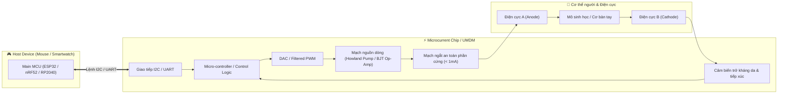

# MICROCURRENT - Universal Microcurrent Driver Module (UMDM)

> **Dự án thiết kế Chip/Module điều khiển vi dòng điện kích thích sinh học (MENS - Microcurrent Electrical Neuromuscular Stimulation) đa năng, siêu nhỏ gọn phục vụ tích hợp vào chuột công thái học, đồng hồ thông minh, vòng đeo tay và thiết bị chăm sóc sức khỏe cá nhân.**

---

## 1. Giới thiệu tổng quan (Introduction)

Trong dự án trước (*Microcurrent Mouse*), mạch vi dòng được thiết kế cố định gắn liền với bo mạch chuột. Hướng tiếp cận này bộc lộ hạn chế:
- Khó tái sử dụng cho các thiết bị khác (đồng hồ thông minh, gối kê cổ tay, thảm massage, v.v.).
- Chiếm diện tích khoang cơ khí của chuột.
- Khó kiểm thử, kiểm chuẩn và chứng nhận an toàn y sinh độc lập.

**Dự án `microcurrent-chip`** chuyển đổi toàn bộ cơ chế kích thích vi dòng thành một **Universal Microcurrent Driver Module (UMDM)** độc lập:
1. **Dạng hình học:** Module kích thước siêu nhỏ (dự kiến $15 \times 20\,\text{mm}$ hoặc module hàn bề mặt Stamp-hole / Castellated holes).
2. **Nguyên lý cốt lõi:** Điều khiển dòng điện hai pha không đổi (Constant Current Biphasic) có độ chính xác cao trong dải $10\,\mu\text{A} - 500\,\mu\text{A}$.
3. **Thích nghi sinh học:** Tự động đo trở kháng da người ($R_{\text{skin}}$ từ $500\,\Omega$ đến hàng chục $\text{k}\Omega$) để điều chỉnh điện áp tải nhằm giữ dòng kích thích không đổi.
4. **Giao tiếp ngoại vi chuẩn hóa:** Giao tiếp với MCU chủ (Host MCU trên chuột hoặc đồng hồ) qua chuẩn I2C / UART với tập lệnh đơn giản (`SET_CURRENT`, `SET_FREQ`, `START`, `STOP`, `READ_IMPEDANCE`).
5. **An toàn phần cứng tuyệt đối (Hardware Failsafe):** Tích hợp mạch ngắt vật lý giới hạn dòng $< 1\,\text{mA}$ độc lập với phần mềm, tuân thủ tiêu chuẩn an toàn dòng rò tiếp xúc sinh học (IEC 60601-1).

---

## 2. Kiến trúc khối hệ thống (System Architecture)



---

## 3. Cấu trúc thư mục dự án

```text
MICROCURRENT/
├── README.md                      # Giới thiệu tổng quan & đặc tả hệ thống
├── ROADMAP.md                     # Lộ trình 5 giai đoạn học & nghiên cứu cho Kỹ sư Tự động hóa
├── docs/                          # Tài liệu kỹ thuật & cơ sở lý thuyết
│   ├── standards/                 # Tiêu chuẩn pháp lý & quy định kỹ thuật y tế
│   │   └── iec-60601-1/           # Hướng dẫn tuân thủ IEC 60601-1 (Intertek), an toàn điện Type BF
│   ├── medical-and-safety/        # 9 tài liệu y sinh: cơ chế tăng sinh ATP, mô hình da Cole-Cole, động học thời gian
│   ├── architecture/              # Sơ đồ thanh ghi I2C (register-map.md) & Tinh chỉnh ngoại vi (peripheral-adaptation-guide.md)
│   └── circuit-theory/            # Phân tích toán học mạch Howland, dung sai cầu trở & trở kháng ngõ ra
├── hardware/                      # Thiết kế & đánh giá phần cứng
│   ├── architectures-comparison/  # Đánh giá 3 Option: Howland + LT5400 vs. High-Side VCCS vs. Dedicated AFE
│   ├── simulation/                # Bản vẽ Schematic LTspice (.asc) & SPICE Netlist (.cir) đã kiểm chứng
│   ├── schematics/                # Sơ đồ nguyên lý mạch KiCad
│   └── pcb/                       # Layout mạch in đa lớp kích thước siêu nhỏ
├── firmware/                      # Mã nguồn nhúng C/C++ điều khiển vòng kín
│   ├── core/                      # umdm_driver.h & umdm_control_loop.c (Soft-start, đo trở kháng, đảo pha Biphasic)
│   ├── protocols/                 # Xử lý lệnh I2C / UART kết nối với thiết bị chủ
│   └── tests/                     # Unit test & kiểm thử trên tải giả (Dummy load)
└── integration-examples/          # Mẫu ứng dụng thực tế
    ├── mouse/                     # Cấu hình tích hợp vào Chuột công thái học
    └── smartwatch-band/           # Cấu hình tích hợp vào Đồng hồ / Vòng đeo tay
```

---

## 4. Đặc tả thông số kỹ thuật sơ bộ (Target Specifications)

| Thông số | Giá trị mục tiêu | Ghi chú |
| :--- | :--- | :--- |
| **Dải dòng điện kích thích** | $10\,\mu\text{A} - 500\,\mu\text{A}$ | Có thể điều chỉnh bước $5\,\mu\text{A}$ qua lệnh |
| **Dạng sóng (Waveform)** | Xung vuông 2 pha đối xứng (Biphasic) | Triệt tiêu điện phân và lắng đọng ion tại da |
| **Dải tần số xung** | $0.5\,\text{Hz} - 100\,\text{Hz}$ | Tối ưu hóa cho sản sinh ATP và thư giãn cơ |
| **Điện áp tải cực đại** | Tối đa $12\,\text{V} - 24\,\text{V}$ (Boost converter) | Đảm bảo dòng chạy qua da khi trở kháng lên đến $20\,\text{k}\Omega$ |
| **Giới hạn dòng ngắt cứng** | $1\,\text{mA}$ | Bảo vệ phần cứng độc lập với vi điều khiển |
| **Điện áp cấp nguồn** | $3.3\,\text{V} - 5.0\,\text{V}$ | Tương thích trực tiếp với pin Li-ion hoặc nguồn USB |
| **Kích thước bo mạch** | $\le 18 \times 22\,\text{mm}$ | Đủ nhỏ để hàn trực tiếp vào vỏ chuột hoặc dây đeo |
| **Giao thức điều khiển** | I2C (Slave) / UART (Baud 115200) | Giao tiếp đơn giản với bất kỳ Host MCU nào |
"# Microcurrent-Chip" 
