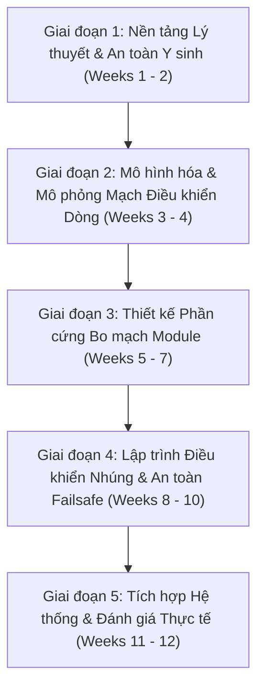

# Lộ Trình Học & Thực Hiện Dự Án: Microcurrent Chip (UMDM)
### Dành riêng cho Kỹ sư Tự động hóa & Kỹ thuật Điều khiển

Lộ trình này được thiết kế theo hướng tiếp cận **chuẩn mực của ngành Kỹ thuật Tự động hóa (Control & Automation Engineering)**: từ nghiên cứu lý thuyết cơ chế sinh học $\to$ mô hình toán học & mô phỏng mạch điều khiển $\to$ thiết kế phần cứng nhúng $\to$ lập trình điều khiển vòng kín $\to$ kiểm thử tích hợp thực tế.

---

## 🧭 Tổng quan lộ trình 5 giai đoạn (Milestones)

---

## 📚 GIAI ĐOẠN 1: Nền tảng Lý thuyết & Tiêu chuẩn Y sinh (Tuần 1 - 2)
> **Mục tiêu:** Hiểu rõ đối tượng điều khiển (Trở kháng da & mô cơ) và giới hạn an toàn tuyệt đối.

### 1. Kiến thức cần học:
- **Cơ chế tác động sinh học của vi dòng (MENS):**
  - Nghiên cứu cơ chế tăng sinh phân tử năng lượng ATP (Adenosine Triphosphate) ở cường độ dòng dưới $500\,\mu\text{A}$ (Cheng et al., 1982).
  - Khái niệm kích thích ngưỡng dưới cảm giác (Sub-sensory): Người dùng không bị giật, không đau nhói như TENS hay EMS thông thường.
- **Mô hình điện học của da người (Skin Impedance Model):**
  - Mô hình Cole-Cole và mạch tương đương Randles (Gồm điện trở lớp sừng $R_s$, điện trở mô sâu $R_t$, và tụ điện màng tế bào $C_m$).
  - Trở kháng da dao động từ $500\,\Omega$ (khi ẩm/ấn mạnh) đến hơn $20\,\text{k}\Omega$ (khi khô).
- **Tiêu chuẩn an toàn thiết bị y tế (IEC 60601-1):**
  - Giới hạn dòng rò qua bệnh nhân (Patient leakage current).
  - Tầm quan trọng của dòng hai pha (Biphasic waveform) với cân bằng điện tích (Zero Net DC) để chống bỏng hóa học do hiện tượng điện phân ion trên da.

### 2. Hành động cụ thể:
- [ ] Đọc bài báo gốc về MENS: *"The Effects of Electric Currents on ATP Generation, Protein Synthesis, and Amino Acid Transport in Rat Skin"*.
- [ ] Lập bảng thông số mục tiêu: Dải dòng ($10 - 500\,\mu\text{A}$), bước chỉnh ($5\,\mu\text{A}$), dải tần ($0.5 - 100\,\text{Hz}$).
- [ ] Ghi chú chi tiết vào thư mục [`docs/medical-and-safety/`](docs/medical-and-safety/).

---

## ⚡ GIAI ĐOẠN 2: Mô hình hóa & Mô phỏng Nguồn Dòng Điện Tự động (Tuần 3 - 4)
> **Mục tiêu:** Ứng dụng lý thuyết điều khiển tự động vào thiết kế nguồn dòng ổn định trên tải biến thiên.

### 1. Kiến thức cần học:
- **Lý thuyết nguồn dòng (Controlled Current Source):**
  - Mạch bơm dòng Howland (Enhanced Howland Current Pump) dùng Op-Amp.
  - Mạch nguồn dòng một chiều điều khiển bằng điện áp (VCCS - Voltage Controlled Current Source) sử dụng BJT/MOSFET kết hợp Op-Amp hồi tiếp âm.
- **Vấn đề điện áp tuân thủ (Compliance Voltage):**
  - Định luật Ohm: $V = I \times R$. Nếu dòng $500\,\mu\text{A}$ đi qua điện trở da $20\,\text{k}\Omega$, điện áp cần thiết là:
    $$V_{\text{compliance}} = 500 \cdot 10^{-6}\,\text{A} \times 20 \cdot 10^3\,\Omega = 10\,\text{V}$$
  - $\implies$ Cần mạch nguồn tăng áp nhỏ gọn (Mini Boost Converter) nâng từ $3.7\,\text{V}$ (pin) lên $12\,\text{V} - 24\,\text{V}$ để duy trì dòng khi da khô.
- **Kỹ thuật đổi chiều dòng điện (H-Bridge / Biphasic Inverter):**
  - Sử dụng cầu H tín hiệu nhỏ (Analog switch như TS5A3159 hoặc MOSFET kép) để lật cực dòng điện tạo xung Biphasic.

### 2. Hành động cụ thể:
- [ ] Cài đặt phần mềm mô phỏng mạch: **LTspice** hoặc **Texas Instruments TINA-TI**.
- [ ] Mô phỏng mạch Howland Pump với tải thay đổi từ $1\,\text{k}\Omega$ đến $25\,\text{k}\Omega$:
  - Kiểm tra xem dòng điện ra có giữ nguyên ở mức đặt ($100\,\mu\text{A}, 300\,\mu\text{A}$) hay không.
  - Đánh giá băng thông và độ méo xung vuông ở tần số $100\,\text{Hz}$.
- [ ] Lưu file mô phỏng vào [`hardware/simulation/`](hardware/simulation/).

---

## 🛠️ GIAI ĐOẠN 3: Thiết kế Phần Cứng Module Nhỏ Gọn (Tuần 5 - 7)
> **Mục tiêu:** Chuyển từ sơ đồ lý thuyết sang bo mạch thực tế (PCB Module) sẵn sàng tích hợp.

### 1. Kiến thức cần học:
- **Lựa chọn linh kiện chuyên dụng:**
  - Op-Amp dòng phân cực siêu thấp (Low Input Bias Current Op-Amp, ví dụ dòng OPAx3xx hoặc MCP600x).
  - Vi điều khiển quản lý module: Chip siêu nhỏ gọn (như **STM32C011 / STM32G030** TSSOP-20, **CH32V003** 32-bit RISC-V giá siêu rẻ, hoặc **ATTiny1614**).
  - Mạch bảo vệ ngắt cứng (Hardware Current Limiter): Sử dụng diode zener, cầu chì tự phục hồi PPTC hoặc transistor kẹp dòng để đảm bảo kể cả khi MCU bị treo/lỗi, dòng không bao giờ vượt quá $1\,\text{mA}$.
- **Kỹ năng thiết kế PCB nâng cao trên KiCad:**
  - Layout bo mạch 2-4 lớp kích thước nhỏ ($18 \times 22\,\text{mm}$).
  - Kỹ thuật cách ly tín hiệu tương tự (Analog Ground) và tín hiệu số (Digital Ground).
  - Thiết kế chân cắm viền (Castellated Holes / Stamp holes) để module có thể hàn phẳng xuống bo mạch mẹ như module ESP32.

### 2. Hành động cụ thể:
- [ ] Vẽ Schematic hoàn chỉnh trên **KiCad**.
- [ ] Phản biện thiết kế (Design Review):
  - Kiểm tra footprint linh kiện SMD 0603 / 0402.
  - Kiểm tra đường thoát nhiệt và bảo vệ tĩnh điện (ESD Protection) cho 2 chân điện cực tiếp xúc da.
- [ ] Đặt gia công PCB và linh kiện mẫu (JLC-PCB hoặc nhà gia công trong nước).
- [ ] Lưu thiết kế vào [`hardware/schematics/`](hardware/schematics/) và [`hardware/pcb/`](hardware/pcb/).

---

## 💻 GIAI ĐOẠN 4: Lập Trình Nhúng & Thuật Toán Tự Động (Tuần 8 - 10)
> **Mục tiêu:** Viết firmware điều khiển thông minh, thích nghi trở kháng và an toàn tối đa.

### 1. Kiến thức cần học:
- **Tạo xung vi dòng chính xác:**
  - Sử dụng Timer ngắt phần cứng (Hardware Timer Interrupt) để định thời chính xác cho xung vuông hai pha.
  - Sử dụng DAC nội hoặc PWM qua bộ lọc tích cực bậc 2 để chỉnh mức dòng mượt mà.
- **Thuật toán điều khiển thích nghi (Adaptive Control):**
  - Tự động đo điện áp trên cảm biến dòng: tính $R_{\text{skin}} = V_{\text{out}} / I_{\text{set}}$.
  - Nhận diện trạng thái:
    - Nếu $R_{\text{skin}} > 50\,\text{k}\Omega$: Không có tiếp xúc tay $\to$ Tắt xung, chuyển chế độ ngủ tiết kiệm pin (Standby).
    - Nếu $R_{\text{skin}}$ nằm trong dải sinh học ($500\,\Omega - 20\,\text{k}\Omega$): Kích hoạt quy trình bơm dòng tăng dần (Soft-start / Ramp-up) để mô cơ thích nghi êm ái.
- **Giao thức truyền thông (I2C / UART Protocol):**
  - Định nghĩa tập thanh ghi (Register Map) chuẩn như các cảm biến công nghiệp (Bosh, TI):
    - `0x01`: `CTRL_REG` (Start / Stop / Mode)
    - `0x02`: `CURRENT_SET` (Cài đặt dòng $\mu\text{A}$)
    - `0x03`: `FREQ_SET` (Cài đặt tần số $\text{Hz}$)
    - `0x04`: `STATUS_REG` (Đang phát / Lỗi mất tiếp xúc / Quá dòng)
    - `0x05`: `SKIN_RESISTANCE` (Giá trị trở kháng da đo được)

### 2. Hành động cụ thể:
- [ ] Viết code firmware trên nền tảng C/C++ (Bare-metal hoặc HAL).
- [ ] Kiểm thử trên tải giả (Điện trở mẫu $1\,\text{k}\Omega, 5\,\text{k}\Omega, 10\,\text{k}\Omega$ song song tụ $100\,\text{nF}$).
- [ ] Dùng dao động ký (Oscilloscope) đo kiểm:
  - Dạng sóng Biphasic có cân bằng không?
  - Dòng điện qua điện trở tải đo được có đúng $100\,\mu\text{A}, 200\,\mu\text{A}$ không?
- [ ] Lưu code vào thư mục [`firmware/`](firmware/).

---

## 🚀 GIAI ĐOẠN 5: Tích Hợp Hệ Thống Thực Tế & Đánh Giá (Tuần 11 - 12)
> **Mục tiêu:** Chứng minh tính "Universal" (Dùng chung) bằng việc gắn vào 2 ứng dụng khác nhau.

### 1. Ứng dụng mẫu 1: Chuột máy tính (Microcurrent Mouse)
- Lấy thân chuột công thái học (hoặc in 3D).
- Lắp module UMDM vào bên trong chuột.
- Nối 2 chân điện cực ra 2 miếng thép không gỉ 316L tại:
  - Vị trí lòng bàn tay tiếp xúc.
  - Vị trí ngón tay cái tựa vào cạnh chuột.
- MCU của chuột điều khiển module qua lệnh I2C (Bật vi dòng khi người dùng làm việc, nghỉ theo chu kỳ Pomodoro 20 phút).

### 2. Ứng dụng mẫu 2: Vòng đeo tay thông minh (Smartwatch Band / Wristband)
- Lắp module vào một dây đeo cổ tay nhỏ gọn.
- 2 điện cực tiếp xúc trực tiếp mặt trong cổ tay (vùng thần kinh giữa - Median nerve).
- Kết nối Bluetooth với điện thoại để tùy chỉnh cường độ kích thích phục hồi cơ bắp.

---

## 🏆 KẾT QUẢ ĐẠT ĐƯỢC SAU DỰ ÁN
Hoàn thành dự án này, bạn và nhóm sẽ có:
1. **Một sản phẩm module phần cứng hoàn chỉnh** có tính ứng dụng cao, vượt trội hơn một đồ án chuột đơn thuần.
2. **Kỹ năng toàn diện của Kỹ sư Tự động hóa**: Mô phỏng giải thuật $\to$ Xử lý tín hiệu analog $\to$ Thiết kế mạch nhúng siêu nhỏ $\to$ Điều khiển thích nghi vòng kín $\to$ Giao tiếp truyền thông chuẩn hóa.
3. **Bộ tài liệu & hồ sơ kỹ thuật chuyên nghiệp** trên GitHub, cực kỳ đắt giá khi ứng tuyển vào các công ty R&D phần cứng, thiết bị y tế hoặc các phòng lab nghiên cứu chuyên sâu.
